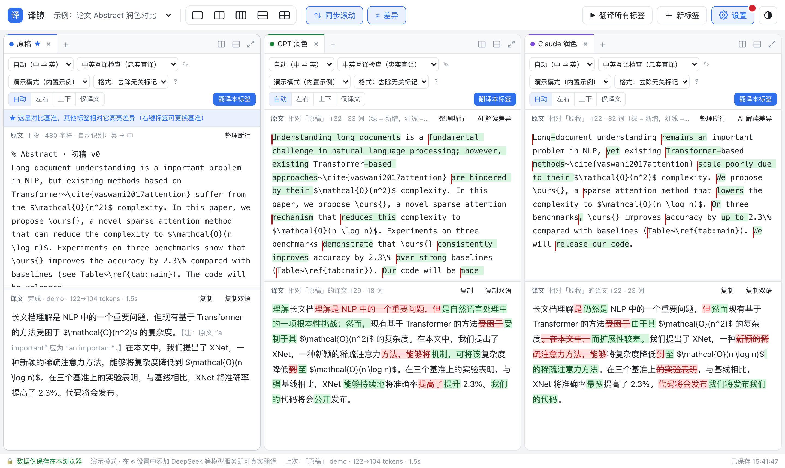

# 译镜 TransLens

**给写论文的人用的「回译检查 + 多版本对照」工作台。**

AI 润色完的英文，到底有没有改掉你的原意？把它忠实地翻回中文，和原稿、其他润色版本并排比较，逐词高亮差异，一眼就能看出来。

- **自带 API Key**：支持 DeepSeek、Claude、OpenAI 等十多家模型服务，按你自己的用量付费
- **纯前端、数据不离开浏览器**：没有后端、账号和统计脚本，内容只保存在你的浏览器里
- **免服务器部署**：构建结果是静态文件，可以免费部署到 Cloudflare Pages 等静态托管



---

## 目录

- [能做什么](#能做什么)
- [三分钟上手](#三分钟上手)
- [使用指南](#使用指南)
- [常见问题](#常见问题)
- [部署](#部署)
- [隐私与安全](#隐私与安全)
- [开发](#开发)

## 能做什么

| 场景 | 怎么做 |
|---|---|
| 检查 AI 润色有没有改意思 | 把润色后的英文粘进标签，用「中英互译检查（忠实直译）」模式翻回中文。这个模式逐句直译，不美化，原文的语法错误或歧义会用【注：…】标出来 |
| 比较多个润色版本 | 每个版本开一个标签，左右或上下并排；打开「≠ 差异」后，原文和译文都会相对基准版本逐词高亮 |
| 让 AI 说清楚版本间的区别 | 点「AI 解读差异」，模型会列出这一版相对基准版本的每处改动，重点指出论断强弱、数字和范围是否变了 |
| 中文初稿写英文 | 方向选「中 → 英」，模式选「论文表达」，得到可以直接放进论文的英文 |
| 翻译带 LaTeX / Markdown 的文本 | 格式选「去除无关标记」，模型会去掉 `\cite`、`\textbf` 等排版标记，只保留公式和需要的内容；选「保留原格式」则所有标记原样保留，只翻译文字 |
| 从 PDF 复制的文本 | 点「整理断行」，把 PDF 复制带来的硬换行、断词接回去 |

## 三分钟上手

1. **打开网站**：用你部署好的网址，或者在本地运行（见[开发](#开发)）。第一次打开是演示模式，内置了一个「论文 Abstract 润色对比」的示例。
2. **先试演示**：点任意标签的蓝色按钮「翻译本标签」，再点顶栏「≠ 差异」，就能看到对比效果。演示模式不联网、不花钱。
3. **填入你的 API Key**：点右上角蓝色的「**⚙ 设置**」（还没配置模型时，按钮上有一个红点）→「模型服务」→ 从模板添加「DeepSeek」→ 粘贴 Key → 点「测试连接」。
   - DeepSeek 的 Key 在 [platform.deepseek.com](https://platform.deepseek.com) 创建，价格便宜，适合日常检查。
4. **开始翻译**：回到主界面，在标签工具条的模型下拉框里选刚添加的服务，粘贴你的文本，点「翻译本标签」（或按 `Ctrl/⌘ + Enter`）。

## 使用指南

### 1. 标签工具条：三个独立的选择

每个标签都有自己的设置，互不影响：

| 选项 | 可选值 | 说明 |
|---|---|---|
| 翻译方向 | 自动（中 ⇄ 英）/ 英 → 中 / 中 → 英 | 「自动」：原文主要是中文就译成英文，否则译成中文 |
| 翻译模式 | 中英互译检查（忠实直译）/ 通顺阅读（意译）/ 论文表达 / 通用翻译 | 决定「怎么翻」。默认是忠实直译，最适合检查意思；旁边的 ✎ 可直接修改这个模式的提示词 |
| 模型 | 你添加的服务和模型 | 不同标签可以用不同模型，方便横向比较 |
| 格式 | 去除无关标记 / 保留原格式 | 格式全部交给模型按提示词处理，本地不改动你的原文；旁边的 ? 有详细说明 |

右侧的「自动 / 左右 / 上下 / 仅译文」切换原文和译文的排布方式。

### 2. 翻译：「翻译本标签」与「翻译所有标签」

- **翻译本标签**（标签工具条上的蓝色按钮，`Ctrl/⌘ + Enter`）：**只翻译这一个标签**，不会影响其他标签。
- **翻译所有标签**（顶栏，`Ctrl/⌘ + Shift + Enter`）：批量翻译当前工作区里还没翻译、或原文改过的标签。发请求前会先列出要翻译哪些标签，让你确认，避免误点花钱。
- **原文直接编辑**：原文框随时可以改，改动会自动保存；标签上出现「●」表示原文改过、译文已过期。
- **只重翻改动的段落**：原文按空行分段，重新翻译时没改动的段落直接用缓存，只有改过的段落会重新请求，又快又省钱。想完全重翻，对已是最新的标签再点一次「翻译本标签」即可。
- **历史版本**：每次翻译都会保留一个版本，翻译过两次以上时，译文区右上角会出现版本下拉框，可以切换查看。
- **复制**：「复制」只复制译文；「复制双语」把原文和译文交替排列后复制。

### 3. 多版本对照

- **新建标签**：顶栏「＋ 新标签」、窗格里的「+」，或 `Alt + T`。
- **重命名**：双击标签名，或按 `F2`。
- **拆分窗格**：窗格右上角的两个按钮分别向右、向下拆分；也可以把标签**拖到**另一个窗格的上、下、左、右边缘来停靠。顶栏的五个图标是常用布局（单栏、左右、三栏、上下、田字格）。
- **调整大小**：拖动窗格之间的分隔线，双击分隔线可以均分。窗格右上角的 ⤢ 可以把它最大化。
- **对比基准**：带 ★ 的标签是基准，其他标签都相对它高亮差异。右键其他标签 →「设为对比基准」即可更换。
- **差异高亮**：顶栏「≠ 差异」（`Alt + D`）。绿色底 = 新增，红色删除线 / 红色竖线 = 删除。悬停在某段译文上，原文对应段落会同时高亮。
- **参考稿**：右键标签 →「转为参考稿」，适合放中文初稿这类不需要翻译、只用来对比的内容。
- **同步滚动**：顶栏「⇅ 同步滚动」让各窗格一起滚动。
- **工作区**：点工作区名称旁的 ⌄ 可以新建、复制、切换工作区，或把整个工作区导出为 Markdown。点名称本身可以直接改名。

### 4. 设置里还能做什么

| 设置页 | 内容 |
|---|---|
| 模型服务 | 添加 / 测试服务、获取模型列表、查询余额（DeepSeek）、填写单价以显示费用、Key 保存方式（保存在本浏览器，或仅本次会话） |
| 翻译模式（提示词） | 修改任意模式的提示词（中文版、英文版都有），随时「重置为原始提示词」；可以「复制为新模式」做自己的版本；底部能预览最终发给模型的完整提示词 |
| 格式处理 | 两种格式模式的规则都可以改、可以重置；也可以登记论文里的自定义宏（如 `\ours = XNet`），让模型知道它代表什么 |
| 术语表 | 每行一条 `原文术语 = 指定译法`。只有本次原文里出现的术语才会写进提示词，节省 token |
| 外观 | 主题、正文字号、正文字体，以及完整快捷键列表 |
| 数据与隐私 | 导出 / 导入备份（JSON，默认不含 Key）、段落缓存开关、清空缓存、申请持久化存储 |

### 5. 支持的模型服务

| 服务 | 说明 |
|---|---|
| DeepSeek | 推荐：便宜、中文好；支持查询余额 |
| Claude | Anthropic 官方 SDK，按需加载 |
| OpenAI、OpenRouter、Gemini（OpenAI 兼容） | |
| 硅基流动、阿里百炼、Moonshot（Kimi）、智谱 GLM | 国内服务 |
| Ollama、LM Studio | 本地模型，完全离线，见下方说明 |
| 自定义 | 任何兼容 OpenAI `/chat/completions` 接口的服务 |

**本地模型（完全离线）**：以 Ollama 为例，启动时需要允许网页访问：

```bash
OLLAMA_ORIGINS="*" ollama serve
```

然后在「设置 → 模型服务」添加「Ollama（本地）」，点「获取模型列表」。

### 6. 快捷键

| 操作 | 快捷键 |
|---|---|
| 翻译本标签 | `Ctrl/⌘ + Enter` |
| 翻译所有标签（会先确认） | `Ctrl/⌘ + Shift + Enter` |
| 新建标签 / 关闭标签 | `Alt + T` / `Alt + W` |
| 向右拆分 / 向下拆分 | `Ctrl/⌘ + \` / `Ctrl/⌘ + Shift + \` |
| 重命名标签 | `F2` |
| 切换到第 n 个标签 | `Alt + 1…9` |
| 差异开关 | `Alt + D` |
| 关闭弹窗 / 菜单 | `Esc` |

## 常见问题

**测试连接失败 / 提示跨域（CORS）错误？**
DeepSeek、Claude、OpenAI 等主流服务都允许浏览器直接调用。如果某个服务不允许，可以部署项目自带的转发代理，见[开启转发代理](#可选开启转发代理)。也请检查 Key 是否正确、账户是否有余额。

**译文段落和原文对不上？**
原文按**空行**分段，每段编号发给模型，译文逐段对应。从 PDF 复制的文本先点「整理断行」。如果模型漏了某段，程序会自动补翻一次。

**会花多少钱？**
状态栏会显示上次翻译的 token 用量；在「设置 → 模型服务」填写单价（每百万 tokens）后，还会显示这次花了多少钱。改了一段只重翻这一段；演示模式不花钱。

**换了浏览器 / 清理了浏览器数据，内容没了？**
所有内容只保存在当前浏览器里，不会同步。请定期在「设置 → 数据与隐私」导出备份，换设备时再导入。

**模型把 `\ref{tab:main}` 翻成了「表 1」？**
默认规则已经要求模型不要编造编号。如果你的模型仍然出现这种情况，可以在「设置 → 格式处理」里加强规则。

## 部署

构建结果是纯静态文件，不需要服务器。

### Cloudflare Pages（推荐，免费）

**方式一：连接 GitHub 仓库（推荐，推送后自动部署）**

1. 把项目推送到你的 GitHub 仓库。
2. 打开 Cloudflare 控制台 → Workers & Pages → 创建 → Pages → 连接到 Git，选择这个仓库。
3. 构建设置：
   - 框架预设：`None`
   - 构建命令：`npm run build`
   - 构建输出目录：`dist`
   - Node 版本由仓库里的 `.node-version` 指定为 22，不需要额外设置。
4. 保存并部署。以后每次推送到主分支都会自动重新部署。

**方式二：本地命令行直接上传**

```bash
npm run deploy
```

第一次运行会打开浏览器登录 Cloudflare，并创建名为 `translens` 的 Pages 项目。

### 可选：开启转发代理

大多数服务不需要代理。少数不允许浏览器跨域调用的服务，可以走项目自带的 Pages Function（`functions/api/proxy.ts`）。它只转发、不记录、不存储：

1. Cloudflare Pages 项目 → 设置 → 环境变量，添加：
   - `PROXY_ALLOWED_HOSTS`：允许转发的域名，逗号分隔，例如 `api.example.com`
   - `PROXY_TOKEN`（可选）：访问口令，防止别人滥用你的代理
2. 重新部署。
3. 在网站的「设置 → 模型服务」里，给该服务勾选「通过代理转发」；如果设置了口令，在代理一栏填写相同的口令。

没有设置 `PROXY_ALLOWED_HOSTS` 时代理返回 404，也就是默认关闭。

### 其他静态托管

运行 `npm run build`，把 `dist/` 上传到 GitHub Pages、Vercel、Netlify 或自己的服务器即可。代理函数只在 Cloudflare Pages 上可用；`public/_headers` 里的安全响应头（CSP 等）只对 Cloudflare Pages 和 Netlify 生效，其他平台需要按各自的方式配置。

## 隐私与安全

- **网络请求只有一种**：从你的浏览器直接发往你配置的模型服务（或你自己部署的代理）。网站本身不收集、不上传任何内容。
- **API Key 只保存在你的浏览器里**，可以设为「仅本次会话」。导出备份默认不含 Key。
- **API Key 永远不要提交到仓库**。本项目做了三层防护：
  1. `.gitignore` 忽略 `.env*`、`.dev.vars`，以及勾选了「包含 API Key」时导出的备份文件 `translens-backup-*.json`。
  2. `npm run check:secrets` 会扫描所有将要提交的文件，发现 `sk-…` 等疑似 Key 就报错。GitHub Actions 每次推送都会自动运行这项检查。
  3. 提交前钩子：克隆仓库后运行一次下面的命令，之后每次 `git commit` 都会先检查暂存的文件。

     ```bash
     git config core.hooksPath .githooks
     ```

- 如果 Key 不小心出现在了提交记录、聊天记录或截图里，请立刻到对应平台作废它，再生成一个新的。

## 开发

需要 Node.js 20.19+ 或 22.12+。

```bash
npm install
```

```bash
npm run dev
```

浏览器打开 http://localhost:5173 。

| 命令 | 作用 |
|---|---|
| `npm run dev` | 本地开发服务器 |
| `npm test` | 单元测试（含模拟接口的「标签互相独立」测试） |
| `npm run typecheck` | TypeScript 类型检查 |
| `npm run check:secrets` | 检查将要提交的文件里有没有 API Key |
| `npm run build` | 构建到 `dist/` |
| `npm run deploy` | 构建并上传到 Cloudflare Pages |

用真实的 DeepSeek 跑一遍冒烟测试。Key 只通过环境变量传入，不会写进任何文件；不设置时这组测试自动跳过：

```bash
DEEPSEEK_API_KEY=你的Key npx vitest run src/app/deepseek.live.test.ts --reporter=verbose
```

目录结构：

```
src/
  core/        与界面无关的纯逻辑：分段、差异、提示词拼装（含单元测试）
  presets/     内置提示词（中英双语）、模型服务模板、演示数据
  llm/         模型调用：OpenAI 兼容（含 DeepSeek）、Claude（官方 SDK，按需加载）
  store/       IndexedDB 存储、应用状态、工作区与布局树
  app/         翻译流水线：分块并发、段落缓存、历史版本、AI 差异解读
  ui/          界面：布局拆分拖拽、标签页、设置、顶栏
functions/api/proxy.ts   可选的 Cloudflare Pages 转发代理
public/_headers          安全响应头（CSP 等）
scripts/check-secrets.mjs  提交前的密钥扫描
docs/                    设计说明（DESIGN.md）、全部内置提示词（PROMPTS.md）
prototype/index.html     最早的单文件交互原型（已被正式版取代，仅供参考）
```

设计细节见 [docs/DESIGN.md](docs/DESIGN.md)，全部内置提示词（中英双语）见 [docs/PROMPTS.md](docs/PROMPTS.md)。

## 许可证

[MIT](LICENSE)
